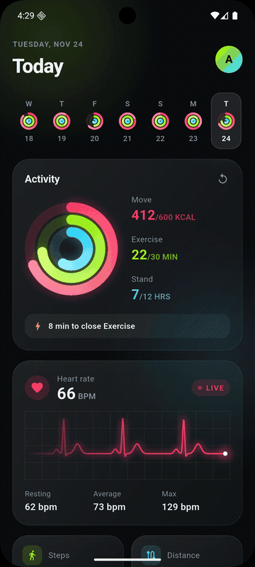

# Pulse — Fitness Dashboard

A motion-rich fitness dashboard built with **Flutter**. Every chart, ring and trace is hand-drawn with `CustomPainter` and animated with Flutter's own animation primitives — **no third-party packages**.

<p align="center">
  
</p>

<p align="center">
  <a href="pulse_demo.mp4">Watch the full-quality MP4</a>
</p>

---

## Highlights

| Feature | What's interesting about it |
|---|---|
| **Activity rings** | Gradient sweeps drawn with `CustomPainter`, staggered easing per ring, neon glow. Progress above 100% keeps lapping with a shadow under the tip so the overlap reads as depth. Switching days tweens from the current position instead of restarting. |
| **Live ECG trace** | The heartbeat is an analytic function of time (P-QRS-T waves built from Gaussians), driven by a `Ticker`, so it scrolls perfectly smoothly at any frame rate. The heart icon pulses on the R-peak and BPM updates once per beat, like a real monitor. |
| **Day selector** | Seven days, each with its own miniature rings (the same widget, reused). Selecting a day updates every card on the screen. |
| **Weekly steps chart** | Bars grow in with a stagger, a dashed goal line, and tap-to-select synced with the day selector. |
| **Streak heatmap** | 20 weeks of activity that ripples in diagonally. Tap or drag a finger across the grid to scrub through days. |
| **Count-up stats** | Steps, distance, sleep and resting heart rate animate to their values, with goal bars that also state progress in text. |
| **Smart insight** | The Activity card tells you the most actionable next step, e.g. *"8 min to close Exercise"*. |
| **Pull to refresh** | Replays every animation on the screen. |

## UX & accessibility details

- **Pressed feedback** on every tappable element (scale-down within ~110 ms that never shifts layout) plus **haptics** on selection.
- **Touch targets** of at least 48 dp; the tiny heatmap cells use snap-to-nearest and drag scrubbing instead of precise taps.
- **Reduced motion** respected: with the OS setting on, animations jump to their end state and the ECG shows a still frame.
- **Screen reader labels** on the rings, day chips, bars, heart rate and heatmap.
- **Never colour alone**: goal progress is also written as text ("77% of goal"), and the heatmap has a caption and legend.
- **Text scaling** follows the system font size, capped at 1.3× so dense tiles stay legible.
- **Shared design tokens** for colours, text styles and motion timing in [`lib/theme.dart`](lib/theme.dart).

## Tech

- Flutter 3.50 / Dart 3.14, Material 3, dark theme
- `CustomPainter`, `Ticker`, `AnimationController`, `TweenAnimationBuilder`, `AnimatedSwitcher`, `BackdropFilter` (frosted glass)
- Runs on Android, iOS, web and desktop. On wide screens it renders inside a phone-sized frame so the demo still reads as a mobile app.

## Project structure

```
lib/
├── main.dart                     # App entry, theme, phone frame for wide screens
├── theme.dart                    # Colour, text and motion tokens
├── data/
│   └── fitness_data.dart         # Mock week, heatmap data, streak logic
├── screens/
│   └── dashboard_screen.dart     # Layout, entrance stagger, pull to refresh
└── widgets/
    ├── activity_rings.dart       # Ring painter + multi-lap animation
    ├── heart_rate_card.dart      # Live ECG painter and BPM
    ├── day_selector.dart         # Day chips with mini rings
    ├── weekly_steps_card.dart    # Animated bar chart
    ├── streak_heatmap_card.dart  # Heatmap painter with scrubbing
    ├── stat_tile.dart            # Count-up metric tiles
    ├── animated_count.dart       # Number tween text
    ├── glass_card.dart           # Frosted glass surface
    └── pressable.dart            # Press feedback + haptics
```

## Getting started

```bash
git clone <your-repo-url>
cd pulse_dashboard
flutter pub get

# Android emulator or a connected device
flutter run

# Web
flutter run -d chrome
```

Run the tests:

```bash
flutter test
```

## Notes

All data is mock data generated in [`lib/data/fitness_data.dart`](lib/data/fitness_data.dart) — no accounts, permissions or network access needed.
